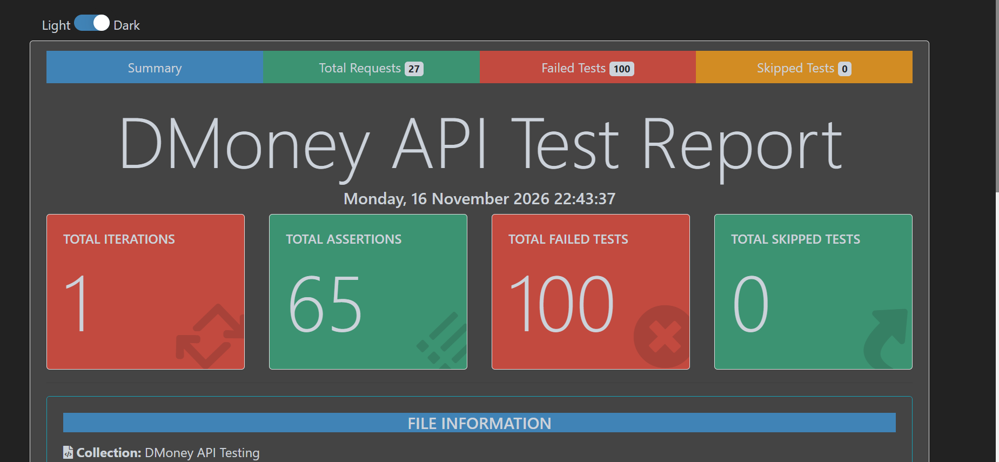

# DMoney API Testing (Postman + Newman)

Integration tests for the DMoney **user** and **transaction** APIs, written as a Postman collection and run with Newman.
This is the Batch 20 assignment "Integration testing with Postman".

## Links

| Item | Link |
|---|---|
| Postman collection (test cases) | [DMoney_API_Testing.postman_collection.json](DMoney_API_Testing.postman_collection.json) |
| Published API documentation | PASTE_REAL_POSTMAN_DOCS_LINK_HERE |

## Flow covered

1. Create 2 customers, 1 agent and 1 merchant through the API.
2. Activate the four users with the admin API.
3. Deposit 5000 tk from the SYSTEM account (`system@dmoney.com` / `1234`) to the agent.
4. The agent deposits 2000 tk to Customer 1. **Assert the deposit commission.**
5. Customer 1 sends 1000 tk to Customer 2. **Assert the service fee.**
6. Customer 2 cashes out 500 tk from the agent. **Assert the service fee.**
7. Customer 2 pays 400 tk to the merchant.

Every request has assertions on the status code, response time and response body. The collection has **27 test cases**: 19 positive and 8 negative.

## Test cases

| # | Folder | Test case | Type |
|---|---|---|---|
| 1 | 0. Authentication | Admin Login | Positive |
| 2 | 0. Authentication | System Login | Positive |
| 3 | 1. Create Users | Create Customer 1 | Positive |
| 4 | 1. Create Users | Create Customer 2 | Positive |
| 5 | 1. Create Users | Create Agent | Positive |
| 6 | 1. Create Users | Create Merchant | Positive |
| 7 | 1. Create Users | Create user with duplicate email and phone | Negative |
| 8 | 1. Create Users | Create user without auth token | Negative |
| 9 | 2. Activate Users | Activate Customer 1 | Positive |
| 10 | 2. Activate Users | Activate Customer 2 | Positive |
| 11 | 2. Activate Users | Activate Agent | Positive |
| 12 | 2. Activate Users | Activate Merchant | Positive |
| 13 | 2. Activate Users | Activate user without auth token | Negative |
| 14 | 3. System Deposit | System deposits 5000 tk to Agent | Positive |
| 15 | 3. System Deposit | System deposit to a non-existent account | Negative |
| 16 | 4. Agent Deposit | Agent Login | Positive |
| 17 | 4. Agent Deposit | Agent balance is 5000 after system deposit | Positive |
| 18 | 4. Agent Deposit | Agent deposits 2000 tk to Customer 1 (deposit commission) | Positive |
| 19 | 4. Agent Deposit | Agent deposit more than agent balance | Negative |
| 20 | 5. Send Money | Customer 1 Login | Positive |
| 21 | 5. Send Money | Customer 1 sends 1000 tk to Customer 2 (service fee) | Positive |
| 22 | 5. Send Money | Send money more than balance | Negative |
| 23 | 6. Cashout | Customer 2 Login | Positive |
| 24 | 6. Cashout | Customer 2 cashout 500 tk from Agent (service fee) | Positive |
| 25 | 6. Cashout | Cashout from a non-existent agent | Negative |
| 26 | 7. Payment | Customer 2 pays 400 tk to Merchant | Positive |
| 27 | 7. Payment | Payment to a non-existent merchant | Negative |

Phone numbers, emails and NIDs are generated randomly in pre-request scripts, so the collection can be run again and again. Tokens and ids are stored in environment variables and reused by later requests, so the folders must run in order.

## Project structure

```
.
├── DMoney_API_Testing.postman_collection.json   # test cases
├── DMoney.postman_environment.json              # environment variables
├── run.js                                       # Newman runner (reads .env, writes the HTML report)
├── package.json
├── .env.example                                 # copy to .env
├── .gitignore                                   # node_modules, Reports, .env
└── screenshots/                                 # report screenshot used below
```

## How to run

1. Start the DMoney server on `http://localhost:5000`.
2. Install dependencies:
   ```bash
   npm install
   ```
3. Create your `.env` file and fill in `secretKey`, `adminEmail` and `adminPassword`:
   ```bash
   cp .env.example .env
   ```
4. Run all tests and generate the report:
   ```bash
   npm test
   ```
   The HTML report is written to `Reports/report.html`.

To run it in Postman instead, import the collection and the environment, select the **DMoney Env** environment, fill in the three secret values and use **Run collection**.

### Configuration

| Variable | Meaning |
|---|---|
| `baseUrl` | API base URL, default `http://localhost:5000` |
| `secretKey` | Value of the `X-AUTH-SECRET-KEY` header |
| `adminEmail`, `adminPassword` | Admin credentials |
| `systemEmail`, `systemPassword`, `systemAccount` | SYSTEM account credentials and account number |
| `depositCommissionRate` | Agent commission on a deposit, as a fraction of the amount |
| `sendMoneyFee` | Fixed fee for send money, in tk |
| `cashoutFeeRate` | Cashout fee as a fraction of the amount |
| `path...` | Endpoint paths, so they can be changed in one place |

## Newman report



> Replace `screenshots/newman-report.png` with a screenshot of your own `Reports/report.html` after running `npm test`.

## API documentation

Published documentation: `<ADD POSTMAN DOCUMENTATION LINK HERE>`
